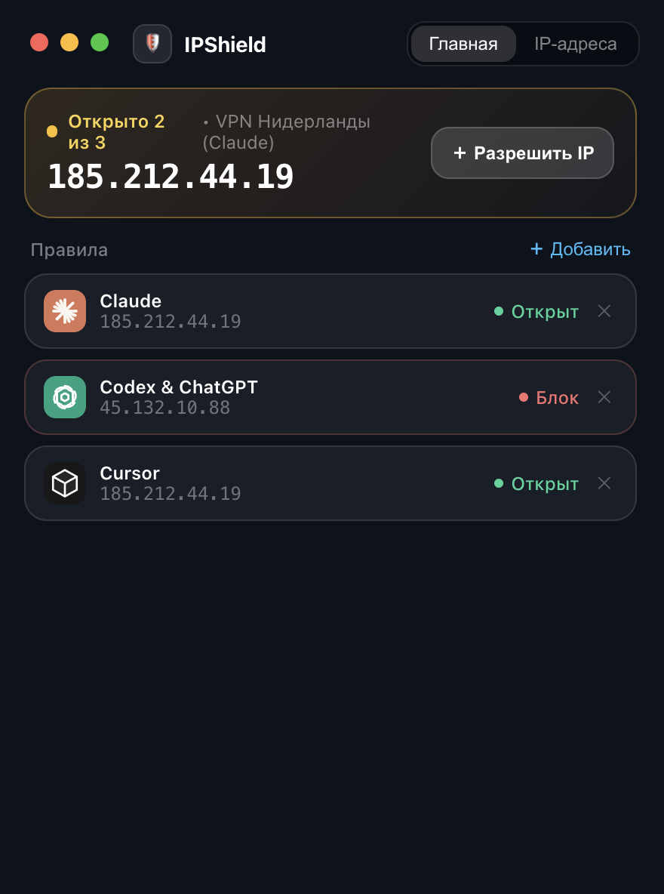
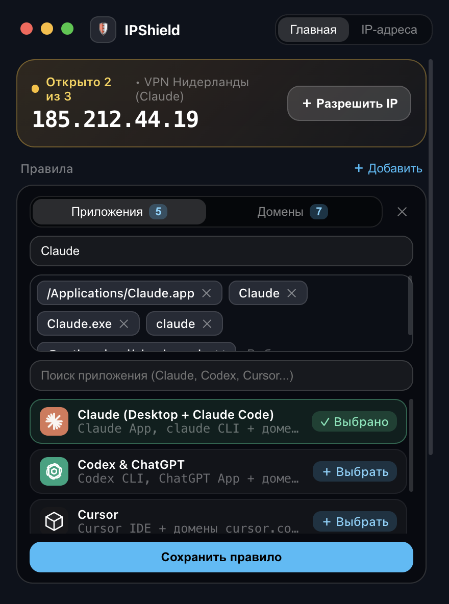
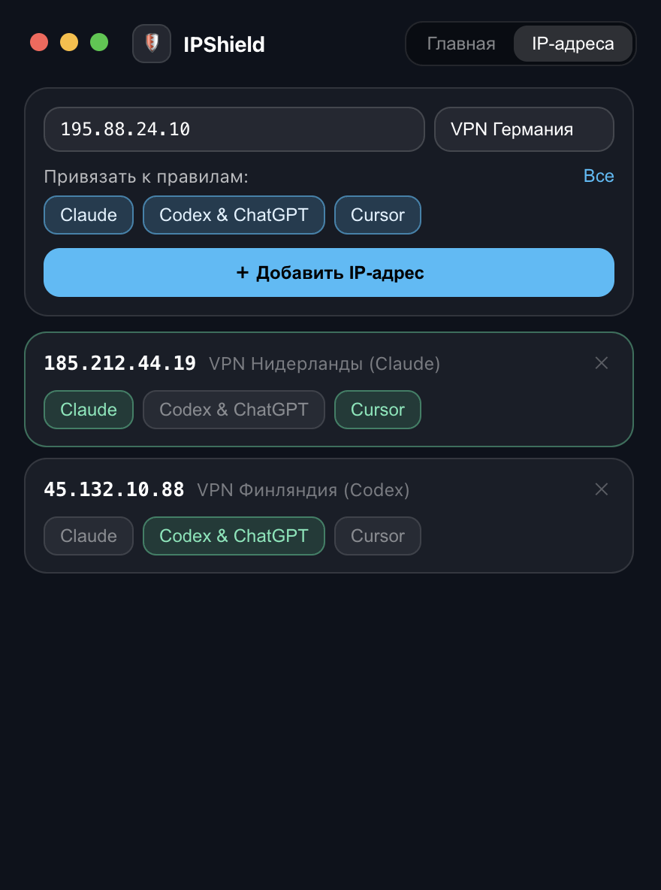
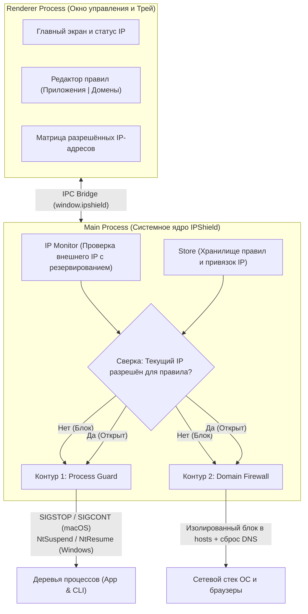

<div align="center">
  

  <h1>IPShield</h1>

  <p>
    <strong>Умный Kill-Switch и сетевой экран для AI-инструментов и десктопных приложений</strong><br />
    Строгий контроль доступа для <b>Claude Desktop</b>, <b>Claude Code CLI</b>, <b>OpenAI Codex</b>, <b>ChatGPT</b>, <b>Cursor</b>, <b>Perplexity</b>, <b>Gemini</b> и любых пользовательских программ и доменов по статическому IP-адресу.
  </p>

  <p>
    <a href="https://github.com/Ramzil11/IPShield/releases/latest"></a>
    <a href="https://github.com/Ramzil11/IPShield/actions"></a>
    
    
    
    <a href="LICENSE"></a>
  </p>

  <p>
    <a href="https://github.com/Ramzil11/IPShield/releases/latest">
      
    </a>
  </p>
</div>

---

## О приложении

При работе с зарубежными AI-сервисами и CLI-агентами (**Claude**, **Claude Code**, **Codex**, **ChatGPT**, **Cursor**) критически важно, чтобы запросы шли **только** с закреплённого статического VPN/Proxy IP-адреса. Случайное отключение VPN или переключение на другой узел во время работы может привести к блокировке аккаунта.

**IPShield** решает эту задачу автоматически в фоновом режиме:
- Вы привязываете свои статические IP-адреса к нужным приложениям и доменам (например, `VPN #1` — только для **Claude**, а `VPN #2` — только для **Codex**).
- Если текущий внешний IP не совпадает с разрешённым для конкретного правила, **IPShield** мгновенно **замораживает процессы приложения** (без закрытия окна и потери сессии) и **блокирует его домены** в системе.
- Как только вы подключаетесь к нужному статическому IP — доступ автоматически открывается.

### Ключевые возможности
- **Индивидуальная привязка IP к правилам**: разные статические IP можно закрепить за разными AI-инструментами.
- **Заморозка процессов без потери контекста**: вместо принудительного завершения (`kill`) процессы переводятся в состояние паузы (`SIGSTOP` на macOS / `NtSuspendProcess` на Windows) и продолжают работу с того же места после восстановления IP.
- **Блокировка доменов в браузере и API**: автоматическая фильтрация доменов (`claude.ai`, `api.anthropic.com`, `chatgpt.com`, `api.openai.com` и др.) на уровне ОС.
- **Редактируемые шаблоны и свои правила**: встроенные пресеты для популярных AI-сервисов с возможностью добавлять или удалять любые процессы и домены через чип-редактор (`Tag-Input`).
- **Индикатор в строке меню (Menu Bar / System Tray)**: иконка щита в трее меняет цвет (🟢 Активен / 🟡 Частично открыт / 🔴 Заблокировано) и показывает текущий внешний IP по клику.
- **Встроенное автообновление**: проверка новых версий на GitHub Releases и обновление в один клик прямо из приложения.

---

## Установка и первый запуск

Готовые установочные файлы собраны под **macOS** и **Windows** и доступны во вкладке **[Releases](https://github.com/Ramzil11/IPShield/releases/latest)**:

| Платформа | Установочный пакет | Описание |
| :--- | :--- | :--- |
| **macOS** (Apple Silicon) | `IPShield-...-arm64.dmg` | Классический установщик (перетащить в «Программы») |
| **macOS** (Portable / Update) | `IPShield-...-arm64-mac.zip` | Архив с готовым приложением `IPShield.app` |
| **Windows** (Инсталлятор) | `IPShield.Setup....exe` | Установщик с созданием ярлыков и автозапуском |
| **Windows** (Портативная) | `IPShield....exe` | Запуск без установки в систему |

---

### ⚠️ Важно для пользователей macOS (Первый запуск)

> [!NOTE]
> **IPShield** — бесплатный проект с открытым исходным кодом. У приложения нет платного коммерческого сертификата Apple Developer ID ($99/год). Из-за этого встроенная система защиты macOS Gatekeeper (особенно на **macOS 15 Sequoia** с Apple Intelligence и **Sonoma**) при первом открытии файла, скачанного из браузера, блокирует запуск с сообщением:  
> *«"IPShield" is damaged and can't be opened. You should move it to the Trash»*.  
> В macOS Sequoia Apple **убрала** кнопку «Всё равно открыть» из Системных настроек для неподписанных программ.

Файл **не повреждён** — это стандартный карантин macOS на файлы из браузера. Чтобы запустить приложение:

1. Перетащите `IPShield.app` из DMG-образа в папку **«Программы»** (`/Applications`).
2. В окне с ошибкой нажмите **«Cancel»** (Отмена, **не** перемещайте в корзину).
3. Откройте **Терминал** и выполните команду для снятия метки карантина:
   ```bash
   xattr -cr /Applications/IPShield.app
   ```
4. Запустите приложение — оно откроется сразу и без предупреждений.

> [!TIP]
> **Что с последующими обновлениями?**  
> Выполнять эту команду при обновлениях **не потребуется**! Встроенный апдейтер IPShield скачивает новые версии напрямую из GitHub Releases и автоматически очищает карантин (`xattr -cr`), поэтому все последующие обновления устанавливаются в один клик.

---

### ℹ️ Примечание для пользователей Windows
При первом запуске установщика на Windows может появиться синий экран фильтра **SmartScreen** (*«Система Windows защитила ваш компьютер»*). Нажмите **«Подробнее»** (*More info*) → **«Выполнить в любом случае»** (*Run anyway*).

---

## Скриншоты

<table>
  <tr>
    <td align="center" width="33%">
      
      <br />
      <sub><b>Главный экран</b><br />Текущий IP и статус каждого правила в реальном времени</sub>
    </td>
    <td align="center" width="33%">
      
      <br />
      <sub><b>Редактор правил</b><br />Переключатель «Приложения | Домены» и редактирование процессов</sub>
    </td>
    <td align="center" width="33%">
      
      <br />
      <sub><b>Привязка IP-адресов</b><br />Распределение статических VPN IP по конкретным правилам</sub>
    </td>
  </tr>
</table>

---

## Верхнеуровневая архитектура

Приложение разделено на изолированный UI-слой (**Renderer**) и системное ядро (**Main Process**), которое непрерывно сверяет текущий внешний IP с матрицей правил и управляет двумя контурами защиты:



1. **IP Monitor (`src/main/ipMonitor.ts`)** — опрашивает пул независимых IP-эндпоинтов с коротким таймаутом и мгновенно фиксирует смену внешнего IP-адреса.
2. **Store (`src/main/store.ts`)** — локальное персистентное хранилище (`ipshield-config.json` в системной директории `userData`), связывающее правила (`appPaths`, `processes`, `domains`) со списком разрешённых IP.
3. **Process Guard (`src/main/processGuard.ts`)** — сканирует таблицу процессов ОС, находит основные процессы и дочерние деревья по путям бандлов и CLI-аргументам и замораживает/размораживает их при смене статуса правила.
4. **Domain Firewall (`src/main/domainFirewall.ts`)** — управляет секцией `# >>> IPSHIELD START >>>` в системном файле `hosts` (с однократной выдачей ACL-прав без повторных запросов пароля) и сбрасывает системный DNS-кэш.

---

## Системные требования

- **Операционная система**:
  - **macOS** 12.0 (Monterey) и выше (Apple Silicon `arm64` / Intel `x64`)
  - **Windows** 10 / 11 (`x64`)
- **Для сборки из исходного кода**:
  - **Node.js** `>= 18.x`
  - **npm** `>= 9.x`

---

## Для разработчиков: сборка из исходного кода

### 1. Клонирование и установка зависимостей
```bash
git clone https://github.com/Ramzil11/IPShield.git
cd IPShield
npm install
```

### 2. Запуск приложения в режиме разработки
```bash
npm start
```

### 3. Запуск автоматических тестов (Vitest)
```bash
npm test
```

### 4. Локальная сборка установочного пакета (`.dmg` / `.exe`)
```bash
# Сборка для macOS (.dmg и .zip)
npm run pack:mac

# Сборка для Windows (NSIS installer и Portable .exe)
npm run pack:win
```

---

## Лицензия

Проект распространяется с открытым исходным кодом под лицензией **[MIT License](LICENSE)**.
